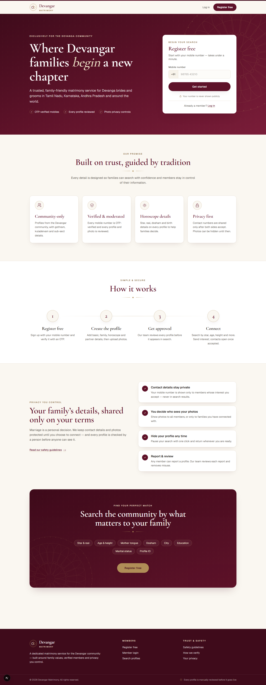
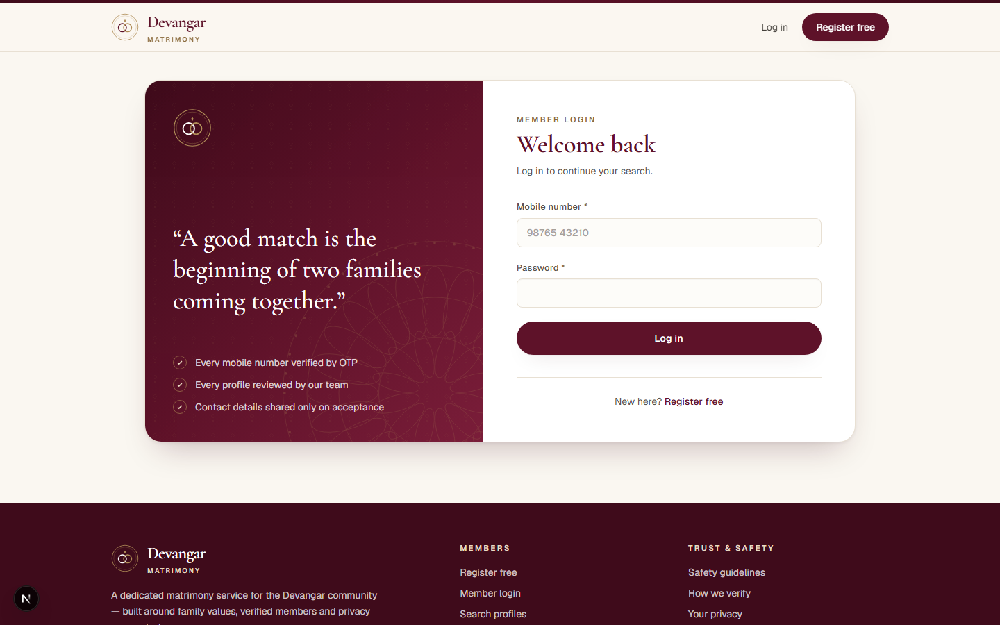
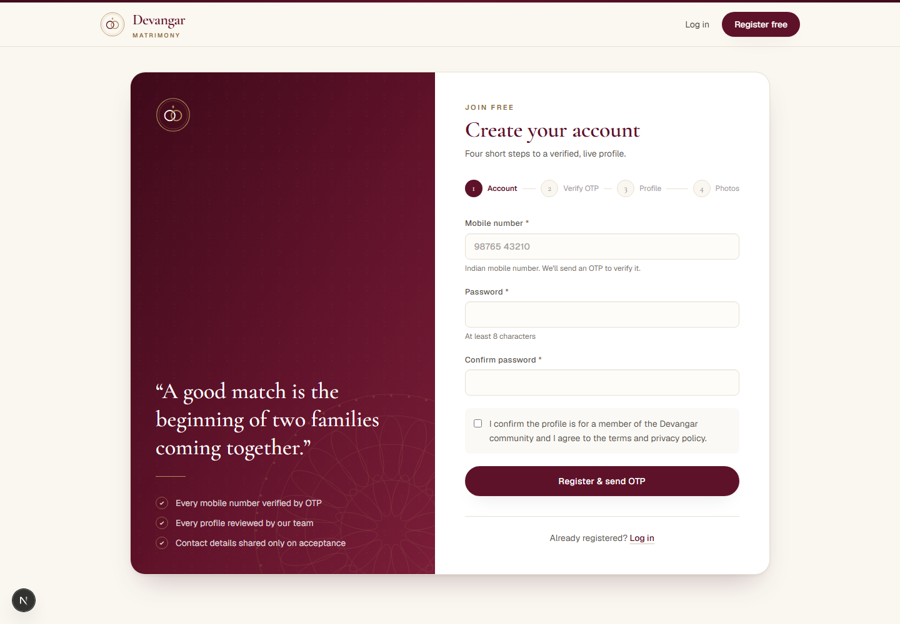
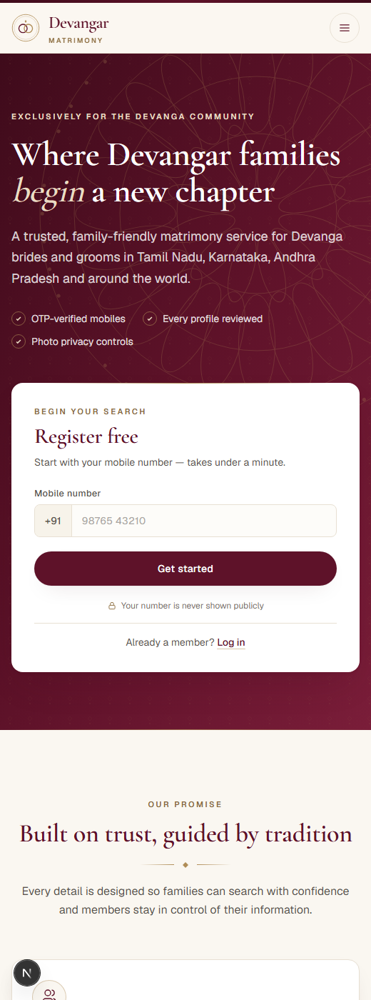

# Devangar Matrimony

Matrimony web app for the Devangar (Devanga) community. Built with Next.js 15 (App Router), PostgreSQL, Prisma and Tailwind CSS.



## Live demo (runs on GitHub)

[](https://codespaces.new/HEMAANAND-M/devangar-matrimony?quickstart=1)

1. Click the button above (you need a GitHub account; personal accounts include free Codespaces hours).
2. Wait 2–3 minutes while the Codespace installs packages, creates the database and loads demo data.
3. The app opens in a new browser tab. If it doesn't, open the **Ports** tab and click the globe icon next to port 3000.
4. Log in with a demo account (type the 10-digit number):

| Role         | Mobile                    | Password     |
| ------------ | ------------------------- | ------------ |
| Admin        | `9000000000`              | `admin12345` |
| Demo brides  | `9000000100` – `9000000102` | `demo12345`  |
| Demo grooms  | `9000000103` – `9000000105` | `demo12345`  |
| Moderator    | `9000000001`              | `moderator123` |

`DM90005` (Demo Karthik) is a Premium member and `DM90002` / `DM90005` are ID-verified, so the badges are visible in the demo.

When you register a new account, the OTP is printed in the Codespace **terminal** (no SMS is sent in the demo).

To stop using free hours, stop the Codespace from <https://github.com/codespaces> when you are done.

## Screenshots

| Login | Register | Mobile |
| ----- | -------- | ------ |
|  |  |  |

## Features

See [CHANGELOG.md](CHANGELOG.md) for what changed in each version, [docs/ADMIN_GUIDE.md](docs/ADMIN_GUIDE.md) for running the admin portal, [SECURITY.md](SECURITY.md) for how members are protected, and [docs/INCIDENT_RESPONSE.md](docs/INCIDENT_RESPONSE.md) for what to do if something goes wrong.

**Matchmaking**
- Registration with mobile number + password and OTP verification; password reset by OTP
- Detailed profiles: gothram, kuladeivam, sub-sect, star, rasi, lagnam, dosham, birth details, education, family, lifestyle and partner preferences (stars, cities, dosham, education, own-gothram rule)
- **Horoscope (jathagam) upload** (PDF or image) with a South Indian rasi chart, visible to all members or only accepted matches
- **Thirumana porutham** — 10-porutham star compatibility (Dinam, Ganam, Mahendram, Stree Deergham, Yoni, Rajju, Vedhai, Rasi, Rasi Adhipathi, Vasyam) on every profile
- Search by age, height, sub-sect, stars, rasi, dosham, mother tongue, marital status, cities, education, gothram rule, photo, ID verified, recently active and profile ID; sort by **match score**
- **Saved searches** with daily alerts; **visitors** page (who viewed / shortlisted you)
- Recommended matches, **who viewed my profile**, and a profile-strength meter on the dashboard
- Send / accept / decline / withdraw interests
- **Chat** after an interest is accepted (when either member is premium), with read receipts and in-chat report/block
- **Phone numbers shared only with permission**: a member requests the number and it is shown after the other member approves
- Shortlist, hide/unhide profile, report and **block** members
- Success stories, FAQ, community events and a support inbox
- Installable on phones (PWA), branded link previews for WhatsApp / social sharing

**Admin portal**
- Dashboard with 30-day charts, queue ages and the bride/groom balance by city
- Member search and records with timeline, devices, notes and logged actions (suspend, ban, force sign-out, reset password, grant premium, mark married, export, erase)
- Review queues for profiles (keyboard shortcuts), photos (duplicate detection), reports (categories, priority, notes) and ID / selfie verifications, with automatic risk flags
- Payments with refunds and GST invoices, editable plans and coupons, announcements, notification log, content, events, dropdown lists and feature switches
- Staff management and a complete activity log with CSV export

**Membership & trust**
- **Premium plans via Razorpay** (3 / 6 / 12 months, editable by admins, coupons supported): chat, phone-number requests, visitors, 30 interests a day (free: 5), gold Premium badge. Signature-verified checkout plus an idempotent webhook; no-charge demo checkout until keys are added
- **ID verification**: Aadhaar (masked), PAN, Passport, Voter ID or Driving licence. Only the last 4 characters are stored; the document is AES-256-GCM encrypted, admin-only, and deleted on review (or after 30 days)
- **Family accounts**: a parent or sibling manages the profile with their own login (invite bound to their OTP-verified number, up to 2)
- **Moderator role**: staff can moderate profiles, photos and reports without access to payments, ID documents, phone numbers or staff management
- **WhatsApp notifications** (Cloud API, opt-in): interest received, interest accepted, profile approved, weekly new-matches digest
- **Photo protection**: watermark burned into every photo; profile photos blurred until tapped, re-blurred when the app loses focus, right-click/long-press save disabled

**Security & privacy**
- Staff sign in with an SMS code, are signed out after 30 idle minutes, and can be limited to office IPs (`ADMIN_IP_ALLOWLIST`)
- Suspended and banned accounts are refused on every request; sign-in history with hashed IPs
- Daily profile-view cap per account to stop bulk harvesting of profiles
- Nonce-based Content Security Policy, HSTS, frame blocking and other security headers
- Postgres-backed rate limiting on login, registration, OTP, password reset, reports and uploads (works across serverless instances)
- Sessions in signed `HttpOnly` / `SameSite` cookies (`__Host-` prefixed in production), revocable via password change or "log out of all devices"
- Photos re-encoded on upload: **EXIF/GPS location stripped**, decompression bombs rejected, served only through an access-checked route
- Contact details (phone numbers, emails, social handles) blocked in profile text and interest messages
- Account deletion that removes all personal data (DPDP Act right to erasure)

**Performance**
- WebP photos resized to 1200px plus 480px thumbnails for cards, with ETag caching
- Image bytes stored apart from photo metadata so lists never load them
- Per-request user caching, parallel queries and targeted database indexes
- Skeleton loading states and self-hosted fonts

## Setup

Requirements: Node.js 20+ and PostgreSQL 14+.

```bash
npm install
cp .env.example .env        # then fill in DATABASE_URL and SESSION_SECRET
npx prisma migrate dev --name init
npm run db:seed             # admin account + 6 demo profiles
npm run dev
```

Open http://localhost:3000.

Seeded logins (development only):

| Role  | Mobile           | Password     |
| ----- | ---------------- | ------------ |
| Admin | +919000000000    | admin12345   |
| Demo  | +919000000100–105 | demo12345   |

Log in with the 10-digit number (e.g. `9000000000`).

### OTP and SMS

In development the OTP is printed in the terminal running `npm run dev`:

```
[OTP] +919876543210: 123456
```

For real SMS set `SMS_PROVIDER`:

| Provider | Settings |
| --- | --- |
| `msg91` (recommended in India) | `MSG91_AUTH_KEY`, `MSG91_TEMPLATE_ID`: a DLT-approved OTP flow template whose variable is `otp` |
| `twilio` | `TWILIO_ACCOUNT_SID`, `TWILIO_AUTH_TOKEN`, `TWILIO_FROM` |
| `console` | Prints codes to the log. Refused in production unless `ALLOW_CONSOLE_SMS=true` (for a demo deployment only) |

Production refuses to send codes until a provider is configured. If an SMS fails, members see a friendly error and can retry straight away.

### Staff sign-in

Admins and moderators sign in with their password **and** an SMS code (`/login/staff`), and are signed out after 30 minutes without activity. For a local demo you can skip the code with `STAFF_2FA=off`; never set that on a public deployment.

Suspended and banned members (set from Admin → Members) cannot sign in; any open session stops working immediately, and the login page shows the reason. Suspensions with an end date lift themselves.

## Payments, WhatsApp and scheduled jobs

| Setting | Where to get it |
| --- | --- |
| `RAZORPAY_KEY_ID`, `RAZORPAY_KEY_SECRET` | Razorpay Dashboard → Account & Settings → API Keys (use Test keys first) |
| `RAZORPAY_WEBHOOK_SECRET` | Razorpay Dashboard → Webhooks → add `https://<your-domain>/api/razorpay/webhook` with events `order.paid`, `payment.captured`, `payment.failed` |
| `WHATSAPP_TOKEN`, `WHATSAPP_PHONE_NUMBER_ID` | Meta for Developers → WhatsApp → API Setup (use a permanent System User token in production) |
| `CRON_SECRET` | Any long random string; `vercel.json` runs `/api/cron/weekly` every Monday 09:00 IST and `/api/cron/cleanup` daily at 02:30 IST |

Plan prices live in `src/lib/premium.ts`.

Create these WhatsApp message templates (category **Utility**, language **English**) in Meta Business Manager; the variables are filled in this order:

| Template name | Example body |
| --- | --- |
| `interest_received` | Hello {{1}}, you have a new interest from profile {{2}} on Devangar Matrimony. View it here: {{3}} |
| `interest_accepted` | Good news {{1}}! Profile {{2}} accepted your interest. View the profile: {{3}} |
| `profile_approved` | Hello {{1}}, your Devangar Matrimony profile is now live. Start searching: {{2}} |
| `weekly_matches` | Hello {{1}}, {{2}} new profiles matching your preferences joined this week: {{3}} |

Until WhatsApp is configured, messages are recorded with status "not configured" and visible to admins.

## Operations

### Scheduled jobs

| Job | Schedule | What it does |
| --- | --- | --- |
| `/api/cron/weekly` | Monday 09:00 IST | WhatsApp weekly-matches digest; expires ID documents nobody reviewed within 30 days |
| `/api/cron/cleanup` | Daily 02:30 IST | Deletes accounts that never verified their number within 7 days (and have no profile), expired codes, old rate-limit windows, and sign-in history older than 180 days |

Both need `Authorization: Bearer $CRON_SECRET`; Vercel Cron sends it automatically. To run one by hand: `curl -H "Authorization: Bearer $CRON_SECRET" https://<your-domain>/api/cron/cleanup`.

### Photo storage

Photos are stored in the database by default, which is fine for a few thousand members. To move them to [Vercel Blob](https://vercel.com/docs/storage/vercel-blob), create a Blob store in the Vercel project. That sets `BLOB_READ_WRITE_TOKEN`, and new uploads go to Blob. Older photos keep being served from the database.

Every photo is still served through `/api/photos/[id]` with the same access checks. The blob path is derived from the photo id with a server secret, so it can't be guessed. Keep `PHOTO_STORAGE_KEY` (or `SESSION_SECRET`, if that key isn't set) stable, or existing blob photos can no longer be found.

### Backups

Neon and most managed Postgres hosts keep point-in-time backups. Keep your own daily copy as well:

```bash
DATABASE_URL=postgresql://... scripts/backup.sh            # Linux/macOS: writes backups/devangar-YYYYMMDD-HHMMSS.sql.gz
```

```powershell
$env:DATABASE_URL = "postgresql://..."; .\scripts\backup.ps1   # Windows
```

Each run keeps the newest 14 copies. Schedule it with cron or Task Scheduler and copy the folder off the server. To restore: `gunzip -c backups/devangar-….sql.gz | psql "$DATABASE_URL"`.

### Monitoring

- **Uptime:** point UptimeRobot or Better Stack at `https://<your-domain>/api/health`. It answers `200 {"ok":true}` when the app and database are up, and `503` otherwise. A 1–5 minute interval is plenty.
- **Errors:** every unhandled server error is logged as one JSON line (visible in Vercel → Logs). Set `SENTRY_DSN` to also receive them in Sentry. Only the route, error message and stack are sent, never cookies, headers or member data.

## Project layout

```
prisma/schema.prisma      data model
prisma/seed.ts            admin + demo data
src/app/actions/          server actions (auth, profile, interactions, admin)
src/app/api/photos/[id]   authenticated photo delivery
src/lib/                  session, OTP, access rules, helpers
src/components/           shared UI
```

## Mobile app

The site installs as an app on Android and iPhone ("Install the app" in the footer on Android, or Share → Add to Home Screen on iPhone). It opens full screen at the dashboard and shows a branded offline page without a connection. The service worker only caches the build's static files, never member pages, photos or data.

To publish in the Google Play Store without a separate codebase, package the deployed site as a Trusted Web Activity with [PWABuilder](https://www.pwabuilder.com) (enter the live URL and choose Android). Then host the generated  at .

## Next steps before launch

- Configure an SMS provider (MSG91 DLT template registration takes a few days)
- Create a Vercel Blob store once the member base grows
- Terms of service, privacy policy and compliance with India's DPDP Act 2023
